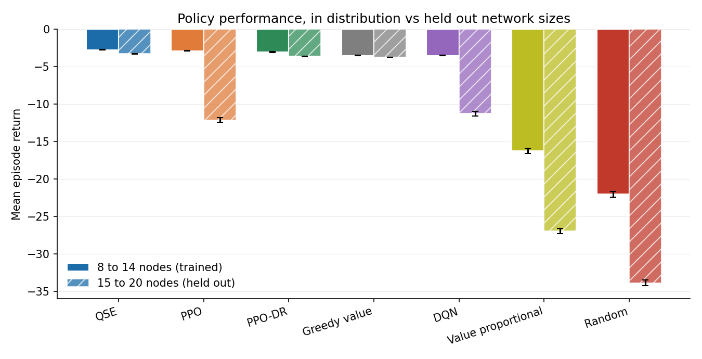
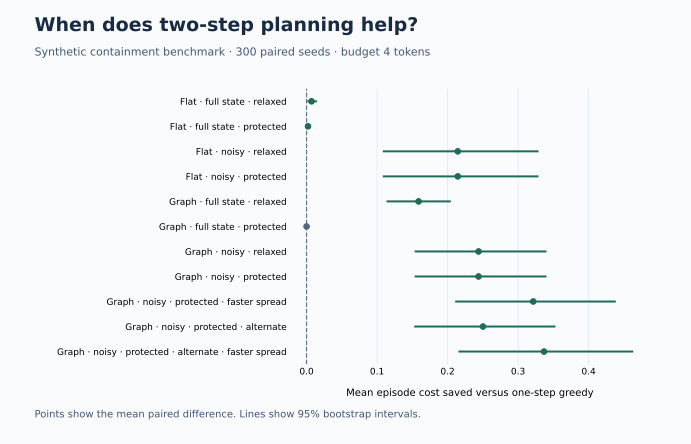
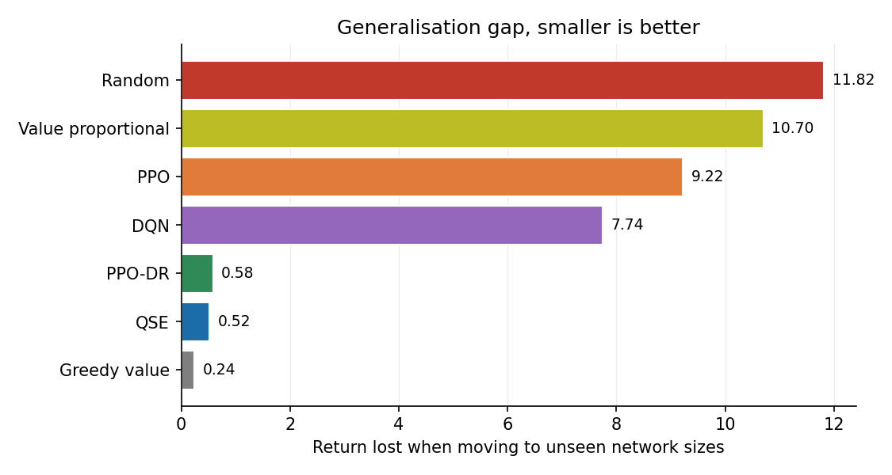
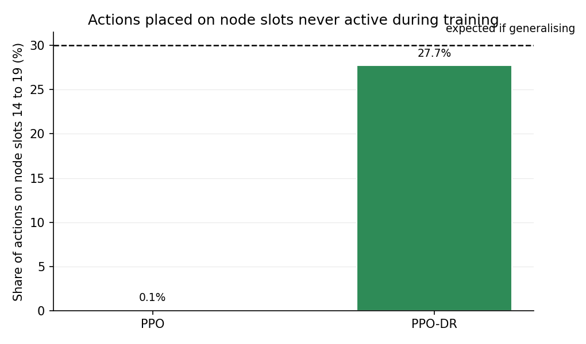
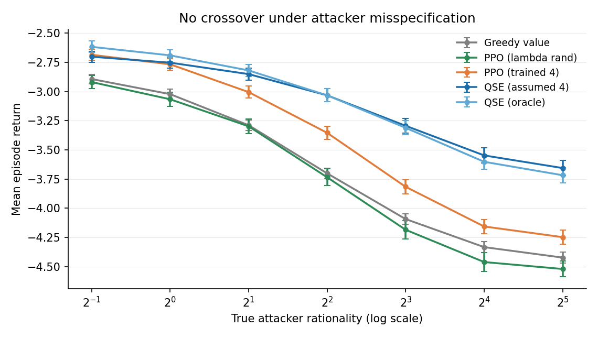
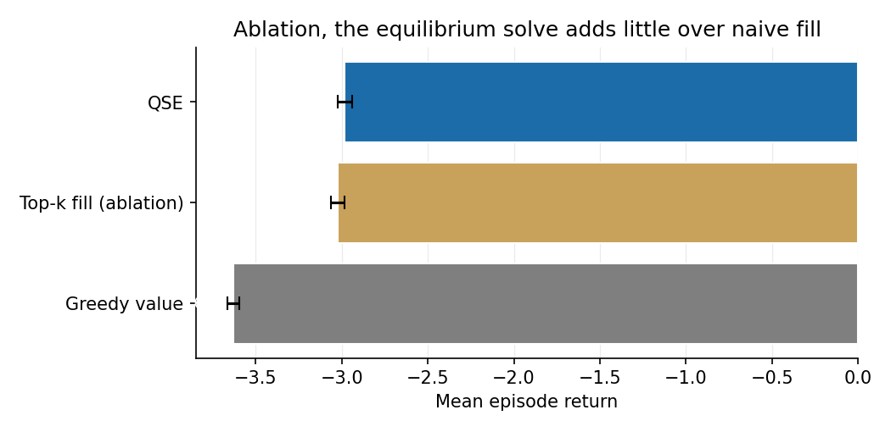
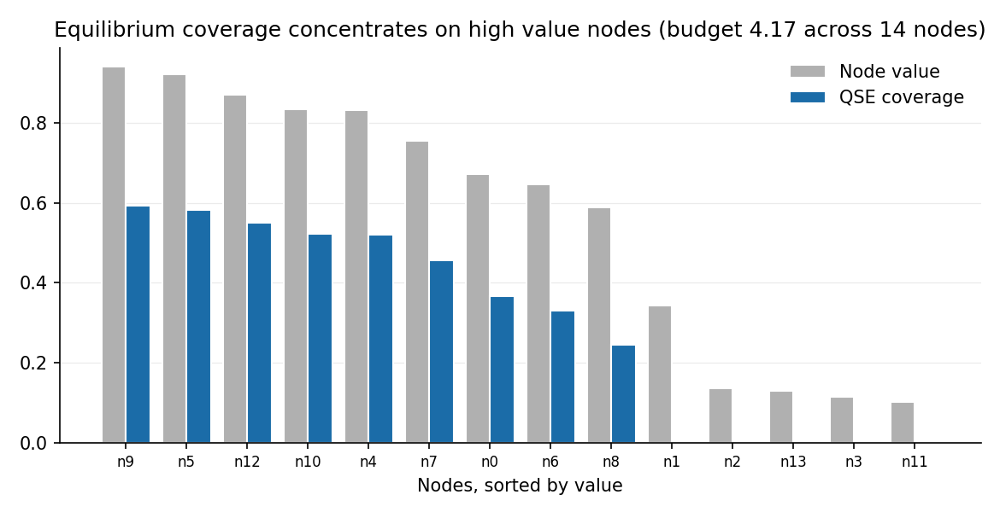

# Network Defense RL

Reinforcement learning for sequential cyber defense, benchmarked against a
Quantal Stackelberg Equilibrium solver.

A defender allocates scarce hardening and incident response effort across a
network while a boundedly rational attacker probes it. The number of nodes
changes every episode, which turns out to be where the interesting behaviour
lives.

The original two studies and ablation below examine size generalisation,
attacker misspecification, and the contribution of the equilibrium solver.
The new containment study asks how those lessons change once an attacker
must move through a network and a defender must preserve services.

**Original experiments.** Learned agents matched the equilibrium solver on the
network sizes they trained on, then lost roughly four times as much value on
sizes they had never seen. One measurement explained why and domain
randomisation fixed it. A follow up study asked whether learning ever
overtakes the equilibrium once the solver's attacker model is wrong, and found
that it does not, at any level of misspecification tested. A final ablation
then showed that the equilibrium solve contributes almost nothing over naive
value ordered allocation, so the real story is not equilibrium reasoning
beating reinforcement learning. It is that a good allocation-tracking
heuristic beats both.



---

## New study: contain lateral movement while keeping services reachable

A five-host, three-zone exercise turns a noisy alert into a ranked set of
analyst actions. It models attack paths and required service flows separately,
keeps true compromise state hidden in noisy regimes, and enforces a shared
response budget. Try the demonstration with `python -m containment recommend`.

In 300 paired simulations of the base graph with noisy alerts and service
protection, two-step planning reduced mean modeled cost from **1.155 to
0.911** versus one-step greedy and critical compromise from **30.7% to 21.0%**.
The planner averaged 1.33 response tokens versus 0.69 for greedy under the
same four-token cap. The two-step open-loop and adaptive variants matched
in the reported runs. The [study notes](docs/containment.md) explain the
ablation, the stress cases, and the assumptions behind the results.



- [Ranked action example](results/containment_demo.json)
- [Benchmark and reproduction commands](docs/containment.md#reproduce)
- [Full results](results/containment_summary.csv) and [budget sensitivity](results/containment_budget_sweep.csv)

The original Gymnasium studies below use the original flat environment.
Its action indices are now bounds-checked, active slots can be queried
through `action_masks()`, and the training wrapper seeds its node-count
sampler. Existing padded checkpoints retain their action-space shape.

---

## Study 1, does padding plus masking give size generalisation?

The environment pads observations and actions to a fixed 20 nodes and carries
an active mask marking which slots are real. This is the standard pattern for
variable sized RL problems, and the working assumption was that it would give
size generalisation for free.

Six policies, 300 episodes each, identical seeds and identical node counts
across policies so differences come from the policy rather than the draw.

### Trained network sizes, 8 to 14 nodes

| Policy | Mean return | SEM | Network value lost |
|---|---|---|---|
| QSE | **-2.75** | 0.042 | 5.1% |
| PPO | -2.91 | 0.042 | 5.4% |
| PPO-DR | -3.06 | 0.041 | 5.8% |
| Greedy value | -3.51 | 0.036 | 7.0% |
| DQN | -3.54 | 0.037 | 7.2% |
| Value proportional | -16.27 | 0.344 | 34.6% |
| Random | -22.06 | 0.359 | 48.2% |

### Held out network sizes, 15 to 20 nodes

| Policy | Mean return | SEM | Network value lost |
|---|---|---|---|
| QSE | **-3.27** | 0.034 | 3.9% |
| PPO-DR | -3.64 | 0.032 | 4.5% |
| Greedy value | -3.75 | 0.028 | 4.6% |
| DQN | -11.28 | 0.332 | 14.7% |
| PPO | -12.13 | 0.328 | 15.8% |
| Value proportional | -26.98 | 0.349 | 36.8% |
| Random | -33.88 | 0.387 | 46.5% |

PPO drops from second place to fifth. DQN does the same. The two policies that
never learned anything barely move.



### Diagnosis

Agents trained on 8 to 14 nodes, so action indices 14 through 19 were never
valid during training. On held out networks those indices cover roughly a
third of the nodes. Counting where the trained policy actually put its
actions:

| Agent | Actions on slots 0 to 13 | Actions on slots 14 to 19 | Share on never trained slots |
|---|---|---|---|
| PPO | 7494 | 6 | 0.08% |
| PPO-DR | 5420 | 2080 | 27.7% |

PPO placed 6 actions out of 7500 on the extra nodes, where roughly 30 to 40
percent would be expected. It did not defend them badly, it did not defend
them at all, and the attacker took them for free.



**The fix.** Domain randomisation over the full 8 to 20 node range. PPO-DR is
the identical architecture and hyperparameters, changing only the distribution
of network sizes it sees. Held out return improves from -12.13 to -3.64, and
usage of the previously dead action slots rises from 0.08 to 27.7 percent,
which confirms the mechanism directly rather than inferring it from the return.

The lesson is that padding plus masking makes variable sized input
*representable*, not *learnable*. If the training distribution never activates
a region of the action space, the policy has no gradient signal about it.

---

## Study 2, does learning ever beat the equilibrium?

QSE needs the attacker's rationality parameter lambda as an input. An RL
defender never sees lambda at all, only reward. So there should be a
crossover. When lambda is known, solving the equilibrium exactly should win.
Once the assumed lambda is far enough from the truth, a policy learned across
a range of attackers should win instead.

There is no crossover.



**Parameter misspecification.** QSE solving every episode as if lambda were 4,
swept against true lambda from 0.5 to 32. It never loses to any learned agent,
including a PPO defender trained with lambda resampled log uniformly over
[0.5, 16] so that it cannot depend on knowing the attacker.

**Structural misspecification.** Replacing the multiplicative quantal response
with an additive subjective utility form in the spirit of Nguyen et al. 2013,
changing the functional form rather than a parameter. QSE still leads, -2.96
against -3.36 for a PPO agent trained directly against that attacker.

**Why.** The equilibrium coverage vector is almost invariant to lambda.
Correlation between the solution at lambda 4 and at every other tested value
ranges from 0.92 to 1.00. Getting the attacker model wrong barely changes what
the defender should do, so there is nothing for a learner to exploit.
Misspecification is not a lever in this environment.

### One positive result

Deliberately assuming a lower lambda than the truth beats solving with the
true one. At true lambda 16 the misspecified solver gains 0.055 return, paired
p = 0.0005, and at lambda 32 it gains 0.061, p = 2e-05. The one shot
equilibrium over concentrates coverage for a sequential game with decay and
remediation, so a deliberately blunted attacker model produces a better
sequential policy. The optimal input to the solver is not the true parameter.

---

## The ablation that reframes everything

If the attacker model is not doing the work, what is? Replace the equilibrium
target with a naive fill that covers nodes in descending value order until the
budget runs out, keeping the same tracking and remediation logic.



| Policy | Mean return | SEM |
|---|---|---|
| QSE | -2.98 | 0.043 |
| Top-k fill (ablation) | -3.02 | 0.041 |
| Greedy value | -3.63 | 0.034 |

The equilibrium solve beats naive fill by 0.042 return, paired p = 0.05 over
300 shared seeds. Borderline at best.

Almost all of QSE's advantage over the greedy heuristic comes from the policy
*structure*, tracking a coverage target and remediating on a marginal utility
threshold, and almost none of it comes from solving the game. QSE is also
handed the exact attacker model the environment uses, an advantage the learned
agents never get.

So the correct reading of the headline tables is not that equilibrium
reasoning beats reinforcement learning. It is that a good allocation-tracking
heuristic beats both, and in this environment the game theoretic machinery is
close to decorative. Establishing that required an ablation that the first
version of this study did not run.



The equilibrium coverage does have non trivial structure. It spreads partial
coverage across nine nodes where naive fill saturates four, correlation 0.73
between the two. The structure is real. It just does not pay off here.

---

## The environment

`NetworkDefenseEnv` is a Gymnasium environment. Each step the defender picks
one node to act on and the attacker picks one to hit.

**Variable node count.** Resampled every episode. Observations and actions pad
to `max_nodes` with an active mask, keeping tensor shapes fixed.

**Binding budget.** Defense decays every step, so sustainable defense mass is
about `1 / defense_decay`, which is 12.5 levels or 4.17 coverage units against
8 to 20 nodes. Without decay a defender with 50 steps could max out every node
at low node counts and allocation would not be a real decision. Decay also
reads naturally in the deception literature, where a measure loses value once
an attacker fingerprints it.

**Prevention versus remediation.** Acting on a clean node hardens it. Acting
on a compromised node cleans it instead. This is the tradeoff that makes the
learned policies worth inspecting.

**Dense damage.** Compromised nodes bleed value every step rather than
incurring a one shot penalty, which gives a dense reward and makes remediation
urgent.

**Attacker.** Quantal response over `value * (1 - coverage)` with rationality
parameter lambda, so zero is uniform random and large values approach a pure
best response. An additive SUQR variant is available via `attacker_model`, and
lambda can be randomised per episode via `rationality_range`.

### Observation and action spaces

```
Observation  Box(max_nodes * 4,)   per node [compromised, value, coverage, active]
Action       Discrete(max_nodes)   which node to act on this step
```

---

## Baselines

| Policy | Description |
|---|---|
| Random | Uniform over active nodes |
| Value proportional | Samples proportional to value times remaining coverage gap |
| Greedy value | Remediate highest value compromised node, else harden highest value node with headroom |
| QSE | Solves the one shot Stackelberg game per episode, then tracks the equilibrium allocation |

The QSE solver maximises defender utility against a quantal responding
attacker,

```
q_i(c)  = softmax( lambda * v_i * (1 - c_i) )
U_d(c)  = - sum_i q_i(c) * v_i * (1 - c_i)
subject to sum_i c_i <= B,  0 <= c_i <= 1
```

solved with SLSQP from several restarts since the objective is not concave in
general. The one shot solution gives a target coverage vector, and the
sequential policy corrects whichever node sits furthest below its target,
remediating instead when the ongoing bleed on a compromised node exceeds the
marginal value of the best available hardening.

---

## Reproducing

```bash
pip install -r requirements.txt

python train.py ppo                # PPO on 8 to 14 nodes
python train.py dqn                # DQN on 8 to 14 nodes
python run_evaluation.py           # both size regimes, writes results/
python misspecification.py         # attacker sweep, writes results/
python ablation.py                 # equilibrium vs naive fill, writes results/
python figures.py                  # writes figures/
```

The three extra agents used in the studies:

```python
from train import train_ppo

# domain randomised over network size
train_ppo(total_timesteps=700_000, node_range=(8, 20), tag="ppo_dr")

# randomised attacker rationality, never told lambda
train_ppo(total_timesteps=700_000, node_range=(8, 20), tag="ppo_lam",
          env_kwargs={"rationality_range": (0.5, 16.0)})

# trained directly against the structurally different SUQR attacker
train_ppo(total_timesteps=700_000, node_range=(8, 20), tag="ppo_suqr",
          env_kwargs={"attacker_model": "suqr"})
```

`notebooks/network_defense_rl.ipynb` walks through everything end to end and
runs on Colab CPU in roughly 25 minutes.

---

## Repository layout

```
network_defense_env.py    Gymnasium environment
baselines.py              Heuristic policies and the QSE solver
train.py                  PPO and DQN training
evaluate.py               Shared seed evaluation harness
run_evaluation.py         Size generalisation study, writes results/
misspecification.py       Attacker misspecification sweep, writes results/
ablation.py               Equilibrium solve vs naive fill
figures.py                All figures
build_notebook.py         Regenerates the Colab notebook
notebooks/                Colab walkthrough
models/                   Trained checkpoints and learning curves
results/                  Episode level and summary CSVs
figures/                  Generated PNGs
```

---

## Honest limitations

**The ablation limits what the QSE comparison shows.** Equilibrium reasoning
beats naive fill by 0.042 return at p = 0.05. Any claim that game theory is
what wins here would be overreach, and the README is written accordingly.

**The attacker is scripted, not learned.** This is single agent RL against a
fixed opponent, not multi agent RL. Self play is the obvious extension.

**QSE is handed the environment's exact attacker model.** Study 2 was built to
attack that advantage and failed to dent it, but the advantage is still real
and worth stating.

**Single training seed per agent.** No variance across training runs. The
evaluation uses shared episode seeds with reported standard errors, but the
training itself is n = 1, so small differences between learned agents should
not be over read.

**DQN received 150k steps against PPO's 700k**, because single environment DQN
with per step gradient updates is far slower in wall clock terms. Its numbers
are a reasonably tuned reference point, not a converged ceiling.

**No topology.** Node values are independent and uniform with no edges. Real
networks have structure, and lateral movement would change the problem
substantially. This is also the most likely reason misspecification did not
bite, since coupled nodes would make the attacker model matter for the
allocation in a way that independent nodes do not.

**Two bugs found and fixed during development.** The first environment let the
defender max out every node at low node counts, making allocation trivial,
which the decay mechanic fixed. The first QSE remediation rule compared
quantities with mismatched units and made QSE lose to plain greedy, which the
marginal utility comparison fixed. The second matters because a quietly
crippled game theoretic baseline would have made the learned agents look
better than they are.

---

## License

MIT
